<!-- Hero art: lotus-pond painting (artist/source unknown). Replace art/source.jpg with an image you have the right to use. -->
<div align="center">

<picture>
  <source media="(prefers-color-scheme: dark)" srcset="assets/hero-dark.svg">
  <source media="(prefers-color-scheme: light)" srcset="assets/hero-light.svg">
  
</picture>

</div>

<div dir="rtl" align="right">

<picture>
  <source media="(prefers-color-scheme: dark)" srcset="assets/banner-about-dark.svg">
  <source media="(prefers-color-scheme: light)" srcset="assets/banner-about-light.svg">
  
</picture>

**فهم** مشروع يشرح مفاهيم العالم باللغة العربية بأسلوب واضح ودقيق وجميل. نؤمن أن المعرفة تُفهم بعمق أكبر، وتنتشر أوسع، حين تُقدَّم بلغة القارئ نفسه.

نجمع في مكان واحد شروحًا مبسّطة للمفاهيم، مع المصطلح الإنجليزي المقابل، وأمثلة من الحياة اليومية، وروابط بين المفاهيم المتقاربة.

- شرح مبسّط لكل مفهوم دون إخلال بالدقة.
- المصطلح الإنجليزي المقابل بجانب كل مفهوم.
- أمثلة من الحياة اليومية تقرّب الفكرة.
- ربط المفاهيم المتقاربة ببعضها.
- تصميم هادئ يسهّل القراءة.

<picture>
  <source media="(prefers-color-scheme: dark)" srcset="assets/banner-fields-dark.svg">
  <source media="(prefers-color-scheme: light)" srcset="assets/banner-fields-light.svg">
  
</picture>

<picture>
  <source media="(prefers-color-scheme: dark)" srcset="assets/fields-dark.svg">
  <source media="(prefers-color-scheme: light)" srcset="assets/fields-light.svg">
  
</picture>

<picture>
  <source media="(prefers-color-scheme: dark)" srcset="assets/banner-how-dark.svg">
  <source media="(prefers-color-scheme: light)" srcset="assets/banner-how-light.svg">
  
</picture>

<picture>
  <source media="(prefers-color-scheme: dark)" srcset="assets/steps-dark.svg">
  <source media="(prefers-color-scheme: light)" srcset="assets/steps-light.svg">
  
</picture>

<picture>
  <source media="(prefers-color-scheme: dark)" srcset="assets/banner-sample-dark.svg">
  <source media="(prefers-color-scheme: light)" srcset="assets/banner-sample-light.svg">
  
</picture>

<picture>
  <source media="(prefers-color-scheme: dark)" srcset="assets/sample-dark.svg">
  <source media="(prefers-color-scheme: light)" srcset="assets/sample-light.svg">
  
</picture>

<picture>
  <source media="(prefers-color-scheme: dark)" srcset="assets/banner-start-dark.svg">
  <source media="(prefers-color-scheme: light)" srcset="assets/banner-start-light.svg">
  
</picture>

```bash
git clone https://github.com/solacode-SC/REPO_NAME.git
cd REPO_NAME
# أضف هنا خطوات تشغيل مشروعك (تثبيت الحزم ثم التشغيل)
```

<picture>
  <source media="(prefers-color-scheme: dark)" srcset="assets/banner-contribute-dark.svg">
  <source media="(prefers-color-scheme: light)" srcset="assets/banner-contribute-light.svg">
  
</picture>

1. افتح **Issue** لاقتراح مفهوم جديد أو لتصحيح شرح موجود.
2. اتبع قالب الشرح: المفهوم، المصطلح بالإنجليزية، التعريف، مثال، مفاهيم مرتبطة.
3. أرسل **Pull Request** بتغييراتك، وسنراجعها معًا.

> **الترخيص:** حدّد ترخيص المشروع هنا (مثال: MIT).

</div>

<div align="center">

<picture>
  <source media="(prefers-color-scheme: dark)" srcset="assets/footer-dark.svg">
  <source media="(prefers-color-scheme: light)" srcset="assets/footer-light.svg">
  
</picture>

</div>
